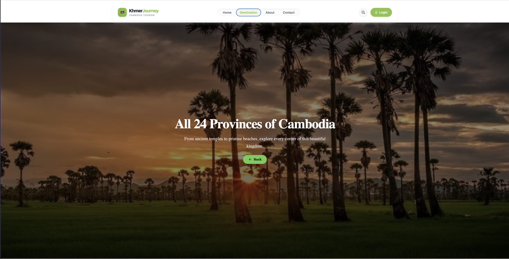

# 🇰🇭 KhmerJourney — Cambodia Tourism Website

A modern, responsive tourism website that helps travelers discover Cambodia: its provinces, ancient temples, cities, and local experiences.

🔗 **Live Demo:** [tourist-cambodia-n9eq.vercel.app](https://tourist-cambodia-n9eq.vercel.app)

---

## ✨ Features

- 🏠 **Home** — hero banner, popular destinations, fun stats, "Why Visit Cambodia?"
- 🗺️ **Destinations** — browse Cambodia's provinces with images, categories, and descriptions
- 🏙️ **Phnom Penh Explorer** — must-visit places (Royal Palace, Aeon Mall, Night Market…)
- 🛕 **Province pages** — e.g. Siem Reap: Angkor Wat, Bayon, Ta Prohm, Pub Street, Tonle Sap
- 📍 **Place detail pages** — opening hours, entrance fee, address, visitor tips
- ℹ️ **About** and ✉️ **Contact** pages
- 🎨 **Login / Sign Up modal** — UI design only (front-end demo, no backend or real authentication yet)
- 📱 Responsive design with a sticky glass-style navbar

> **Note:** The Login / Sign Up screens are a visual prototype. They do not store accounts or verify passwords.

## 📸 Screenshots



## 🛠️ Tech Stack

- **React** + **Vite**
- **React Router**
- **Tailwind CSS** / CSS
- Deployed on **Vercel**

## 📁 Project Structure

```
src/
├── assets/          # icons, images
├── components/
│   ├── common/      # Hero, ProtectedRoute
│   ├── layout/      # Navbar, Footer, AuthModal, LoginModal
│   └── ui/          # StatCard, SocialCard
├── config/          # provinces.config.js
├── data/            # data.js (places & provinces data)
├── features/
│   ├── about/       # AboutCambodia, TeamSection
│   ├── auth/        # Login, SignUp (UI only)
│   ├── contact/     # ContactUs
│   ├── home/        # Banner, FunStats, PopularDestinations, WhyVisitCambodia
│   └── provinces/   # ProvinceOverview, ProvinceList, ProvinceDetail, PhnomPenh*
├── routes/          # AppRoutes.jsx
├── App.jsx
└── main.jsx
```

## 🧭 Routes

| Path | Page |
|------|------|
| `/` , `/home` | Home |
| `/phnompenh` | Phnom Penh explorer |
| `/PhnomPenhExplore/:id` | Phnom Penh place detail |
| `/province` , `/provinces` | All provinces |
| `/provinces/:slug` | Province places (e.g. `siem-reap`) |
| `/provinces/:slug/:id` | Place detail |
| `/about` | About Cambodia |
| `/contact` | Contact |
| `/login` , `/signup` | Login / Sign Up (UI only) |

## 🚀 Getting Started

```bash
git clone https://github.com/Chana758/Tourist_CAMBODIA.git
cd Tourist_CAMBODIA
npm install
npm run dev
```

## 🗺️ Roadmap

- [ ] Real authentication (backend + database)
- [ ] Search across all destinations
- [ ] Khmer / English language switch
- [ ] Favorites and trip planner
- [ ] Interactive map

## 👤 Author

**Chana** — [@Chana758](https://github.com/Chana758)
